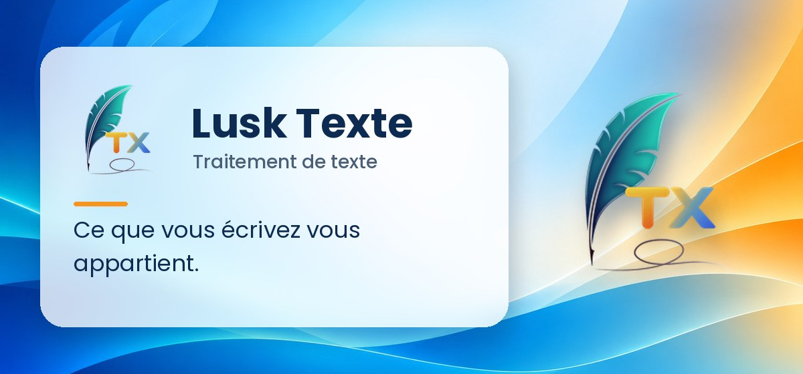
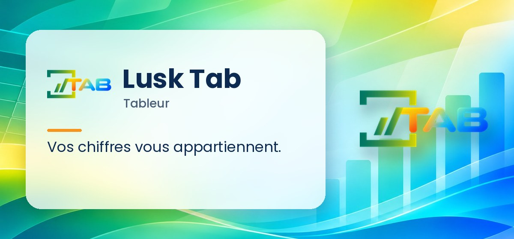
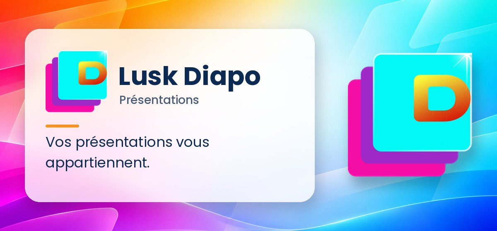
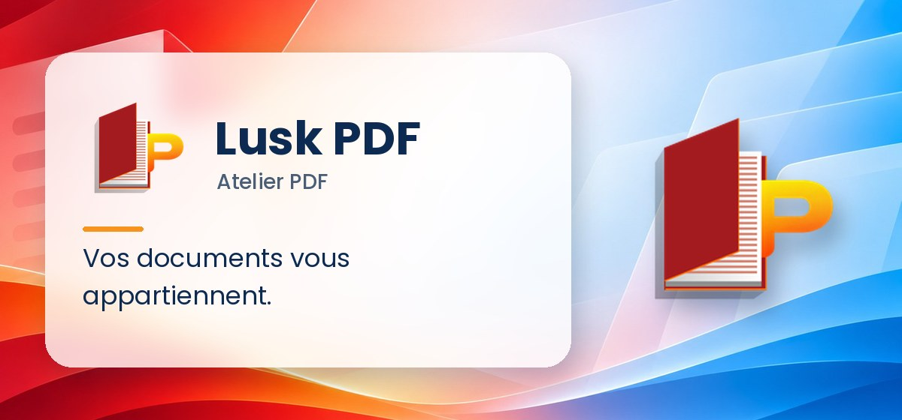
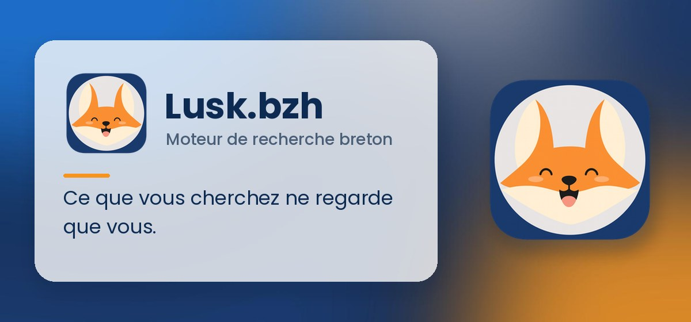
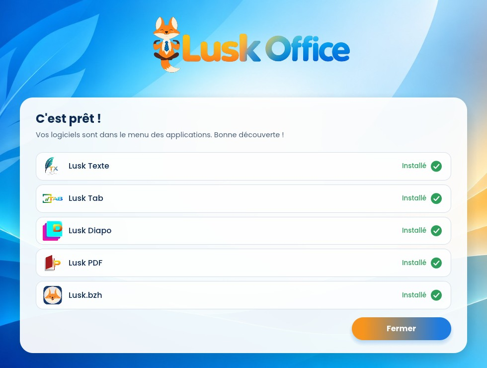

  

<h3 align="center">La suite bureautique libre et gratuite de l'association Lusk</h3>

  Traitement de texte, tableur, présentations, PDF et recherche sur Internet : 
  <b>un seul programme d'installation</b>, où l'on coche les logiciels que l'on veut.

  
  
  

  
  
  
  

---

## Les applications

Tous les logiciels Lusk fonctionnent **entièrement sur votre ordinateur** : pas de compte, pas de
publicité, pas de mesure d'audience, et vos fichiers ne sont jamais envoyés nulle part. Ils sont
en français d'abord, et se mettent à jour d'eux-mêmes.

**Lusk Texte** ouvre et enregistre vos documents Word (.docx, .doc) et OpenDocument (.odt). Styles,
listes, tableaux, en-têtes et pieds de page, un **Mode Livre** pour structurer un roman ou un
essai, et la correction orthographique en français.
[Découvrir Lusk Texte →](https://github.com/declic29/lusktx)

**Lusk Tab** travaille avec vos classeurs Excel (.xlsx, .xlsm), OpenDocument (.ods) et CSV. Des
centaines de fonctions aux noms français (SOMME, SI, RECHERCHEV…), la mise en forme, les
graphiques, les tableaux croisés dynamiques et l'export PDF.
[Découvrir Lusk Tab →](https://github.com/declic29/LuskTab)

**Lusk Diapo** crée et projette vos diaporamas, et ouvre ceux de PowerPoint (.pptx, .potx,
.ppsx). Thèmes, dispositions et idées de conception, images, tableaux, graphiques, transitions
et animations.
[Découvrir Lusk Diapo →](https://github.com/declic29/lusk-diapo)

**Lusk PDF** lit, annote, remplit, signe et organise vos PDF : surlignage et notes, formulaires,
pages à déplacer, extraire ou combiner, export en Word ou en images.
[Découvrir Lusk PDF →](https://github.com/declic29/lusk_pdf)

**Lusk.bzh** est le moteur de recherche souverain breton qui respecte votre vie privée. Lusk
Office l'installe comme une application : il s'ouvre dans sa propre fenêtre, sans barre
d'adresse.
[Aller sur www.lusk.bzh →](https://www.lusk.bzh)

---

## Une installation en trois clics

<table>
  <tr>
    <td width="50%"></td>
    <td width="50%"></td>
  </tr>
  <tr>
    <td align="center"><b>1.</b> Cochez les logiciels que vous voulez</td>
    <td align="center"><b>2.</b> Lusk Office les installe pour vous</td>
  </tr>
</table>

Le fichier contient tous les logiciels : il s'installe **sans Internet**, par exemple depuis une
clé USB. Un logiciel déjà installé dans une version plus ancienne est mis à jour ; un logiciel déjà
à jour est laissé tel quel.

## Télécharger

| Système | Fichier | Pour |
| :-----: | ------- | ---- |
| **Windows** | [LuskOffice-Setup-Windows.exe](https://github.com/declic29/LuskOffice/releases/latest/download/LuskOffice-Setup-Windows.exe) | Windows 10 et 11 |
| **Linux** | [LuskOffice-Setup-Linux](https://github.com/declic29/LuskOffice/releases/latest/download/LuskOffice-Setup-Linux) | Ubuntu 22.04, Linux Mint 21, Debian 12 et plus récents, et leurs dérivées |
| **Mac** | [LuskOffice-Setup-Mac.dmg](https://github.com/declic29/LuskOffice/releases/latest/download/LuskOffice-Setup-Mac.dmg) | macOS 11 et plus récent, Mac Intel et Apple Silicon |

Toutes les versions : [page des publications](https://github.com/declic29/LuskOffice/releases).

<b>Windows</b> : comment ça se passe

Ouvrez `LuskOffice-Setup-Windows.exe`. Windows demande une seule fois l'autorisation d'installer,
puis les logiciels cochés s'installent pour tous les utilisateurs du PC, dans le menu Démarrer
(et sur le Bureau si la case est cochée).

- Lusk.bzh s'ouvre avec Microsoft Edge dans sa propre fenêtre.
- Chaque logiciel se désinstalle depuis « Applications installées » de Windows.

<b>Linux</b> : comment ça se passe

Après le téléchargement, autorisez le fichier à s'exécuter : clic droit, « Propriétés »,
« Autoriser l'exécution du fichier comme un programme » (ou `chmod +x LuskOffice-Setup-Linux`
dans un terminal), puis ouvrez-le. Le mot de passe administrateur est demandé une seule fois ; les
logiciels cochés s'installent pour tout le PC, comme n'importe quel paquet.

- La case « Ajouter les icônes sur le Bureau » place les icônes sur le Bureau de l'utilisateur qui
  installe.
- Lusk.bzh s'ouvre dans sa propre fenêtre avec Edge, Chrome, Chromium, Brave ou Vivaldi s'il y en a
  un, sinon dans un onglet du navigateur par défaut.
- Chaque logiciel se désinstalle comme un paquet ordinaire (`sudo apt remove lusk-tab`,
  `lusk-texte`, `lusk-diapo`, `lusk-pdf`, `lusk-bzh`).

<b>Mac</b> : comment ça se passe

Ouvrez `LuskOffice-Setup-Mac.dmg`, puis « Lusk Office ». Les applis Lusk n'ont pas de certificat
Apple : la première fois, macOS bloque Lusk Office ; ouvrez Réglages Système › Confidentialité et
sécurité, puis cliquez sur « Ouvrir quand même ». Les logiciels installés par Lusk Office s'ouvrent
ensuite sans cet avertissement.

- Les applis cochées sont copiées dans le dossier Applications, sans mot de passe.
- Lusk.bzh s'ouvre dans sa propre fenêtre avec Edge, Chrome, Chromium, Brave ou Vivaldi s'il y en a
  un, sinon dans le navigateur par défaut.
- Chaque logiciel se désinstalle en mettant son appli à la Corbeille.

## Libres et gratuits

Lusk Office et les logiciels Lusk sont des **logiciels libres**, publiés par l'association Lusk
(loi 1901) sous licence MIT ou Apache 2.0 : vous pouvez les utiliser, les copier, les étudier et
les partager librement. Ils sont fournis sans garantie. Le détail est dans
[LICENSE](LICENSE), [LICENSE-APACHE](LICENSE-APACHE) et [NOTICE.md](NOTICE.md).

Une question, un problème ? Ouvrez un [ticket](https://github.com/declic29/LuskOffice/issues) ou
passez sur [www.lusk.bzh](https://www.lusk.bzh).

---

<b>Pour les développeurs</b>

### Comment c'est fait

- Une fenêtre en Rust ([egui](https://github.com/emilk/egui)), aux couleurs de Lusk (`src/main.rs`).
- Les installateurs publiés par chaque logiciel (`.msi` pour Windows, `.deb` pour Linux) sont
  **inclus dans le programme** à la compilation (`build.rs`) : on les met dans `payload/`, avec
  leurs versions dans `payload/versions.txt` (`tab=1.0.2`, `texte=1.1.1`…). Le petit paquet de
  Lusk.bzh pour Linux est fabriqué par `build.rs` avec `dpkg-deb`. Sur Mac, les `.dmg` ne sont
  pas inclus dans le programme mais rangés dans `Contents/Resources` de « Lusk Office.app ».
- Sous Windows, l'installation lance `msiexec` en silence, logiciel après logiciel
  (`src/install.rs`) ; le journal d'une installation qui échoue reste dans le dossier temporaire
  (`%TEMP%\LuskOffice\Lusk-Tab.log`…).
- Sous Linux, `pkexec` lance un script administrateur qui installe les paquets avec apt, l'un
  après l'autre (`src/linux.rs`) ; les journaux sont dans `/tmp/LuskOffice/`.
- Sur Mac, chaque `.dmg` est monté, son appli copiée avec `ditto` à la place de l'ancienne, puis
  le `.dmg` démonté (`src/macos.rs`).
- Les images de cette page sont dans `docs/`.

### Publier une nouvelle version

L'action « Publication » (onglet Actions de GitHub, ou en poussant une étiquette `v1.0.1`)
télécharge les **dernières versions publiées** des quatre logiciels, fabrique
`LuskOffice-Setup-Windows.exe`, `LuskOffice-Setup-Linux` et `LuskOffice-Setup-Mac.dmg` et les
dépose dans une Release en brouillon. Il reste à la publier.

À refaire après chaque nouvelle version publiée de l'un des logiciels, pour que Lusk Office
l'inclue.

### Essayer l'interface

Avec l'une des variables ci-dessous, `cargo run` n'installe rien : l'installation est simulée.
`LUSK_FAKE_INSTALLED="tab=1.0.1"` fait croire qu'une ancienne version est installée ;
`LUSK_DEMO=install` lance tout de suite l'installation simulée, et `LUSK_FAKE_FAIL=Diapo` la fait
échouer pour Lusk Diapo ; `LUSK_DEMO=about` ouvre la page « À propos ».

